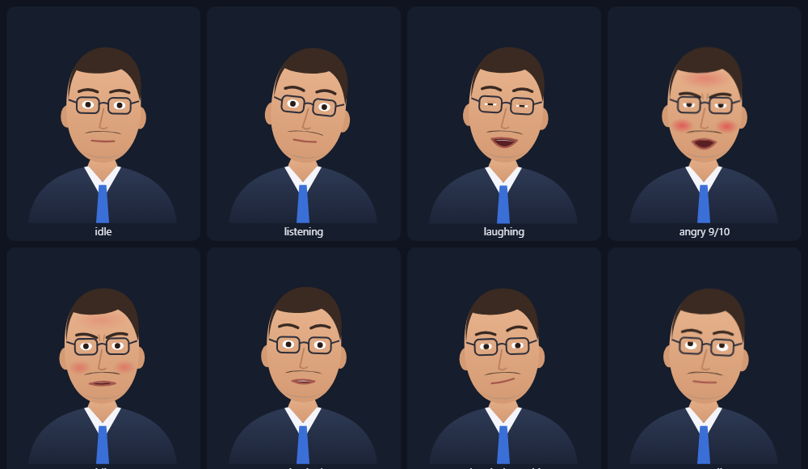
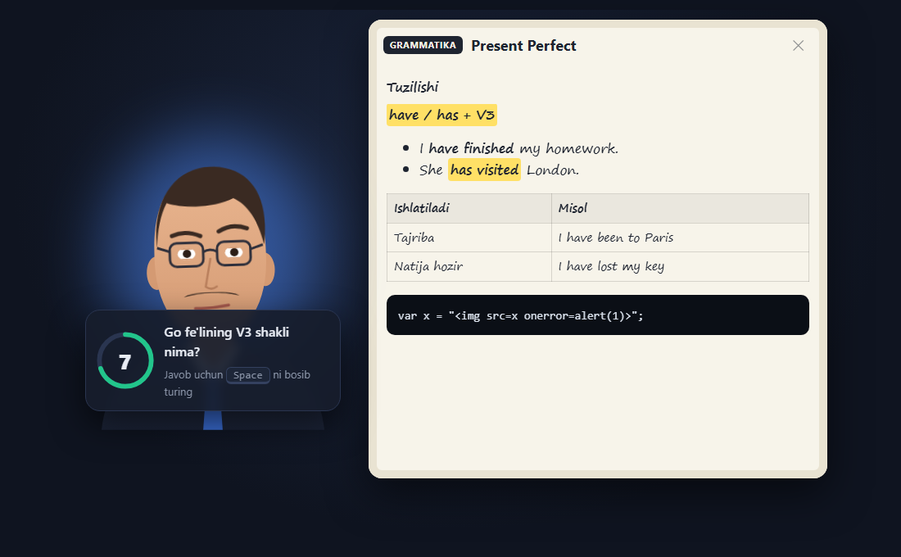
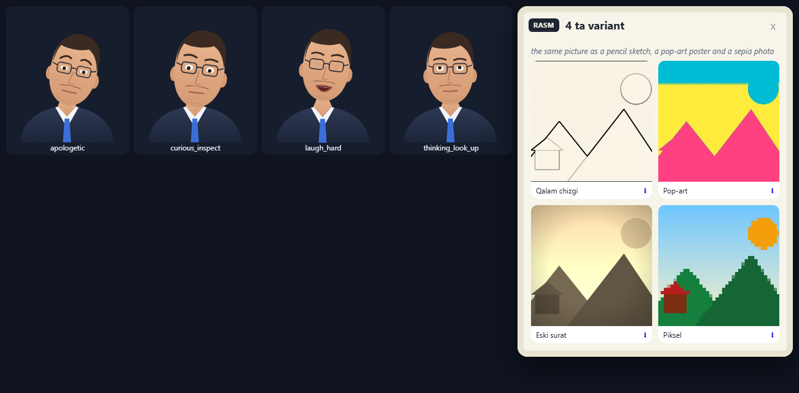
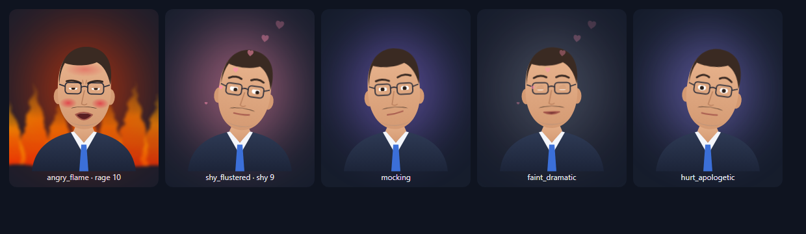
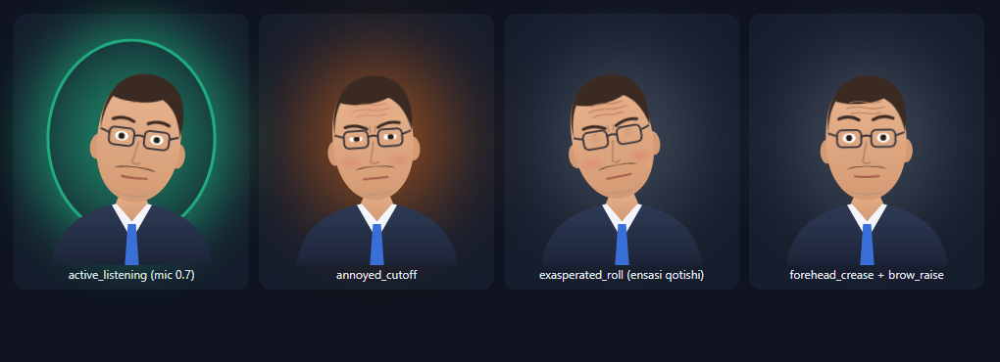
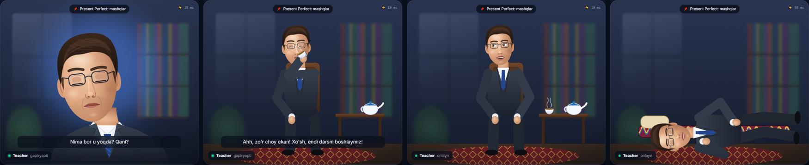

# Teacher AI (Ustoz AI) — voice mentor with a living avatar

**Author / creator: Doston Bunyodov Bunyodovich** — built with C# / .NET (ASP.NET Core).

ASP.NET Core 8 · EF Core + PostgreSQL · SignalR · Claude (LLM) · Azure Speech (STT + TTS with visemes) · vanilla-JS SVG avatar.

## Run (dev)

```powershell
cd src/UstozAI.Api
$env:ASPNETCORE_ENVIRONMENT="Development"
# optional — without these the app runs in offline/demo mode:
$env:ANTHROPIC_API_KEY="sk-ant-..."
$env:AzureSpeech__Key="..."; $env:AzureSpeech__Region="westeurope"
dotnet run --urls http://localhost:5080
```
Open http://localhost:5080 and log in as **doston** with the `Seed:Password` you put in `appsettings.Development.json`
(copy `appsettings.Development.example.json` → `appsettings.Development.json` first; that file is git-ignored).
Migrations run automatically at startup. `GET /api/health` shows which providers are active.

## Architecture

```
Browser                                   ASP.NET Core (.NET 8)                       External
─────────────────────────                 ───────────────────────────────────         ───────────
Space ↓  → Recorder (AudioWorklet)         
          state = listening                 
Space ↑  → state = thinking (instant)      
          16 kHz WAV (base64) ──SignalR──▶ UstozHub.Ask()  [JWT, 2 MB cap, 1 call/conn]
                                            └ ConversationPipeline
                                               1 STT ─────────────────────────────▶ Azure STT (uz-UZ)
          ◀── {transcript}                    2 save user msg ──▶ PostgreSQL
                                               3 LLM stream ───────────────────────▶ Claude (streaming)
          ◀── {emotion}                         └ SentenceChunker (sentence-level)
                                               4 TTS per sentence, pipelined ──────▶ Azure TTS + viseme events
          ◀── {speech: mp3 + viseme cues} ×N    (sentence N synthesizes while LLM writes N+1)
SpeechPlayer: plays chunks in order,          5 save assistant msg + latency ──▶ PostgreSQL
  viseme cue @ audio.currentTime → mouth    ◀── {done}
  AnalyserNode loudness → jaw energy
Space during speech → barge-in (dispose stream → server CancellationToken)
```

**Key choices**
- **SignalR, not raw WebSockets.** Built-in JWT auth, reconnect, and *server-to-client streaming* (`IAsyncEnumerable<TurnEvent>`): disposing the stream on the client cancels the server's `CancellationToken`, so interrupting the avatar is free. Raw WebSockets only pay off for continuous mic streaming into a streaming STT (phase 3b).
- **Audio is WAV, encoded in the browser.** It's provider-neutral (Azure, Whisper and Google all accept it) and avoids webm/opus decoding on the server.
- **Azure Speech** has the best Uzbek coverage: uz-UZ STT plus the `uz-UZ-SardorNeural` / `MadinaNeural` voices. Its TTS also emits **viseme events with audio offsets**, which drive real phoneme-timed lip-sync.
- **No-key fallback:** `TextVisemeSpeech` builds the viseme timeline from the text itself (Uzbek Latin spelling is close to phonetic), and the browser's `speechSynthesis` voices it.
- **Claude** (`claude-opus-5-5`, `effort: low` for fast first tokens, streaming). Server-side refusal fallback is enabled. The persona prompt forces speakable output: no markdown, short sentences, and a leading `[encouraging|explaining|thinking]` tag that drives the avatar's expression.
- **Avatar** is a procedural SVG rig (brows, eyelids/blinks, pupils/saccades, head tilt/nod, 9 mouth shapes). The `Avatar` API (`setState`, `setMouth`, `setEnergy`, `nod`) maps 1:1 onto blendshapes, so swapping in a Three.js GLB bust with ARKit morph targets later doesn't touch the rest of the app.

## PostgreSQL schema (EF Core, `Data/`)

| table | key columns |
|---|---|
| `users` | id uuid PK, username (unique, lower-case), display_name, password_hash (Identity PBKDF2), failed_login_count, lockout_until |
| `user_preferences` | user_id PK/FK, language (BCP-47), voice, avatar_id, speech_rate, time_zone (IANA) |
| `refresh_tokens` | id, user_id FK, token_hash (SHA-256, unique), expires_at, revoked_at, replaced_by_hash |
| `conversation_sessions` | id uuid, user_id FK, **session_date** (user-local day), title (topic preview), language, message_count, last_message_at — **unique (user_id, session_date DESC)** = one thread per day + sidebar index |
| `chat_messages` | id bigserial, session_id FK, role, content, emotion, audio_ms, latency_ms, created_at |

## Daily conversation history

- One thread per user per **local calendar day**. The browser sends its IANA zone (`X-Time-Zone` header, `?tz=` on the hub URL), the server stores it in `user_preferences` and computes "today" from it.
- `POST /api/conversations/today` gets or creates today's thread. It is race-safe: a unique index violation re-reads the winner's row.
- `GET /api/conversations?before=yyyy-MM-dd` returns the sidebar, grouped as `today` / `yesterday` / `last7` / `last30` / `yyyy-MM`, 60 days per page, with a `nextBefore` cursor. Empty past days are hidden. `message_count` and `title` are denormalized, so listing never counts rows.
- `GET /api/conversations/{id}/messages` returns the full day: transcripts, replies, emotion and latency. `DELETE /api/conversations/{id}` removes a day.
- Continuing a day: the client pins `active.id` on every `Ask` / `AskText`. The pipeline loads **that** day's last 40 turns for the LLM and adds a note that it is a continuation from that date. If the tab stays open past midnight, the next turn moves to the new day.
- Migration `DailyConversations` preserves data: old sessions merge into per-day threads.

## Mentor persona, memory & expressions



- **Real level (Postgres):** `student_progress` (CEFR level, stage, realistic IELTS estimate, target, notes), `student_test_results`, `homework_tasks` (Pending/Completed/Failed, `missed_checkins`, feedback), `mentor_states` (anger 0–10, cools down 1 point per 3 h). Every turn `MentorStateService.RenderBrief` injects these facts, so the mentor can expose bragging against the actual numbers.
- **Persona** (`Services/Mentor/MentorPersona.cs`): strict, funny and honest. Laughs at unrealistic claims, then gives a realistic plan. Scolds laziness, excuses and skipped homework, using swearing only in style `strict` at anger ≥ 8. Criticism targets behaviour, never identity. When the student is genuinely struggling, it drops the anger. It always pulls back to the lesson. Style `soft` turns off swearing (`PUT /api/mentor/style`).
- **Homework loop:** at the start of a lesson the brief says "ask about homework first". The model returns `homeworkUpdates` (completed / failed / not_done_yet → `missed_checkins++`) and `assignHomework`, and the server validates ownership, limits and duplicates.
- **Structured output** (Claude structured outputs + `MentorJson.Schema()`): `emotion, angerLevel, facialCues[{cue,segment,at}], speechSegments[{type,emotion,text,intensity}]`, then the actions. `StreamingReplyParser` emits the header and then each segment as soon as its `}` arrives. Anger may change by at most ±4 per turn.
- **Voice:** `speech` segments → TTS with emotion prosody (rate/pitch/volume SSML). `laugh/sigh/gasp/scoff` are **never sent to TTS**: the client plays `wwwroot/sfx/*.mp3` if present (see `sfx/README.txt`), otherwise a procedurally synthesized voice (glottal source → formant filters + breath noise, falling pitch, final inhale).
- **Face** (`js/avatar.js`, `js/mentor.js`): base expression per emotion, anger modulation (furrow, narrowed eyes, flush, frown, fewer blinks), procedural life (random blinks with doubles, slow skeptical blinks, micro-saccades, breathing), timed cues (eye_roll, squint, wide_eyes_shock, smirk, brow_furrow, slow_blink, head_shake, nod, brow_raise) fired at `at × segment duration`. The mouth follows visemes × loudness in speech, and loudness alone in laughter (head bobs with each burst).
- API: `GET /api/mentor`, `PUT /api/mentor/progress/{subject}` (`level` A1–C2, `targetIelts`), `PUT /api/mentor/style`.

## Phase 4: board, pop-quizzes, mistakes, weekly roast



- **Teaching board:** `boardContent {show, type: grammar|vocabulary|code|quiz, title, markdownBody, highlightWords}` streams right after the speech segments. The parser emits it as soon as its `}` arrives, so the board writes itself while Ustoz is talking. The markdown renderer escapes everything first (XSS-tested). Highlight words pulse when the spoken sentence contains them, and the last board of a day comes back when that day is reopened (stored in `chat_messages.meta`).
- **Pop-quiz:** `quiz {active, question, expectedAnswer, timeLimitSeconds 5–60}` creates a `quiz_attempts` row and sends the client only `{id, question, timeLimit}`. The expected answer never leaves the server. The countdown starts once playback is idle (`QuizStarted` stamps the server clock). Space locks the answer time, and the server stores `min(client delay, server elapsed)`, so a faked fast time doesn't work. Timeout calls the hub method `QuizTimeout`. The brief tells the model to grade strictly → `quizResult`. Closed quizzes can't be answered again.
- **Mistakes:** `mistake_logs` (category Grammar/Vocabulary/Pronunciation, user_said, correct_form, normalized key, occurrence_count), with a unique index on (user, category, key). The top 8 go into every brief, so the model says "Yana o'sha xato! … N marta". With the mic set to EN, Azure pronunciation assessment scores each word and words under 70/100 are fed in as pronunciation mistakes.
- **Weekly report:** `GET /api/analytics/weekly-report`: study minutes (per-session gaps capped at 5 minutes + reply audio) vs the previous week, a 7-day chart, active days, homework, quizzes (accuracy, average answer time, timeouts), top mistakes, anger average and peak, level vs target. The 📊 button shows it on the board and calls `WeeklyRoast`, where Ustoz reads the numbers in persona. `GET /api/mistakes?category=` lists all mistakes.

## Phase 5: empathy, universal mentor, images, body language



- **Persona** (`MentorPersona.cs`): a universal study and life mentor that adapts its answer length, and says "I don't know, check the official site" instead of inventing facts. Every turn it classifies `userMood` (neutral/amused/hurt/frustrated/stressed). When the student is **hurt or stressed**, the face goes apologetic *before* audio plays, then comes a sincere apology, encouragement and a gentle return to the topic. No teasing or quizzes in that state, and the server caps anger at 2.
- **Hard boundaries** (`SafetyPolicy.cs`): sexual content, violence or harm instructions, self-harm methods, and illegal or psychotropic drugs. These are refused in Ustoz's own voice (short, firm, then a useful alternative). Educational context such as history or general pharmacology with a doctor disclaimer is still allowed. The model's `safety.category` is enforced on the server: any image job is blocked, anger is reset, a `safety_events` row is written (category only, no message text), and self-harm brings up a support card with **112 / 103**. Claude's own safety training applies on top.
- **Images in:** drag-drop, paste or 📎 → the browser downsizes to ≤1568 px and re-encodes (strips EXIF and GPS) → `POST /api/media` checks magic bytes, a 5 MB cap and a rate limit, and stores the file in `App_Data/media` (not wwwroot) with a `media_assets` row. The turn sends `attachmentIds`. The pipeline links them to the message (`ChatMessage.AttachmentUrl` + `media_assets.message_id`) and passes the images to **Claude vision**: the last 3 image turns as real images, older ones as a text placeholder. Text inside an image is treated as data, never as instructions.
- **Images out:** `imageRequest {action: edit|generate, prompt, count, sourceImageIndex}` → `IImageGenerator`. With `OpenAIImages__ApiKey` set it uses OpenAI `gpt-image-1`; without it, the browser renders canvas variations (sketch/pop-art/sepia/pixel/mirror/noir). The job runs in parallel with TTS. Results are stored as `Generated` assets linked to the assistant message, shown on the board with a lightbox and download, and come back with history.
- **Serving:** `GET /api/media/{id}?exp&sig` uses an HMAC-SHA256 signature with a separate derived key, valid 60 min, `nosniff` + a strict CSP. `` can't send bearer tokens, so the signature is the access check.
- **Body language:** `laugh_hard`, `apologetic_soft`, `curious_inspect` (leans in when an image arrives), `nod_agree`, `shake_head_no`, `thinking_look_up`, `surprised_brow_raise`, plus the `apologetic` and `curious` emotions. Old cue names (`nod`, `head_shake`, `brow_raise`) still work.

**Privacy:** uploaded images are sent to Anthropic (vision) and, when image editing is enabled, to OpenAI.

## Phase 6: character v2 (mood swings, rage/shy, topic pivot)



Full event and JSON contract: **[docs/realtime-contract.md](docs/realtime-contract.md)**.

- **Prompt builder** (`MentorPersona.cs`): sections for Identity (no assistant clichés), Range and length, **MoodSwings**, StyleVocabulary, Empathy, Images, Safety, Teaching and Contract.
  - **Praise** → `shy_flustered`: bashful look, "hozir hushimdan ketib qolaman", then back to work.
  - **Unrealistic dreams** → laughter and `mocking` with real numbers from the DB, then an immediate pivot to the lesson.
  - **Laziness or provocation** → `angry_flame` scolding, then cools down and assigns a concrete task.
- **Styles** (`PUT /api/mentor/style`):
  - `soft`: no insults.
  - `strict` (default): blunt, mild colloquial at rage ≥ 7.
  - `savage` (**opt-in**, "Olovli" in the UI): ahmoq / tupoy / durak / jinni / kasal at rage ≥ 6, dalbayob / dalban at rage ≥ 8, aimed at the student's actions only.
  - `InsultFilter` enforces this on the server *before TTS*, and empathy mode (hurt or stressed) masks everything.
- **Contract v2:** `emotion` (8 values), `rageLevel`, `shyLevel`, `userMood`, `eyeAndFaceCues[{cue, segment, at}]`, `pivotToTopic`, and `speechSegments` with types `speech | laugh_sfx | sigh_sfx | gasp_sfx | scoff_sfx | pause`. `pivotToTopic` is saved as `conversation_sessions.active_topic` and sent back in the next brief, so the lesson continues.
- **Stage** (`js/stage.js`): flame aura with heat shimmer, eased by rage and igniting above about 4, with a tremor at 9 or more. Pink glow and floating hearts for shyness. A 📌 topic pill with a "Mavzuga qaytamiz →" flash after a mood swing.
- **Avatar:** new `blush` channel (pink, separate from the red anger flush), emotions `mocking`, `shy_flustered`, `angry_flame`, `hurt_apologetic`, `teaching`, and cues `bashful_look`, `faint_dramatic`, `wide_eyes`, `head_nod`, `head_shake`.

## Phase 7: active listening, "chala gap", low latency



- **Space hold** (`js/listen.js`, `js/recorder.js`): the AudioContext is unlocked inside the key gesture, and the avatar switches to `active_listening` (leans in, locked eye contact, attentive tilt, a "mm-hm" nod at each pause). A green ring pulses with the live mic level, and a timer counts the clip. The mic stays warm with a 250 ms pre-roll, so the first syllable isn't lost.
- **Cut-off on the client:** a clip shorter than 0.8 s, or with less than 0.25 s of voice, is never uploaded. The face reacts in the same frame (annoyed + `exasperated_roll` + scoff) and the hub method `Cutoff` returns the spoken snap.
- **Cut-off on the server** (`UtteranceGuard`, unit-tested): filler-only transcripts ("ustoz…", "haligi…", "ну это"), a short phrase trailing off with "…", a sentence ending on a conjunction ("…va", "…lekin"), a release mid-word (`clippedEnd`), or a low-confidence short phrase. These skip the LLM: `CutoffReplies` emits the same v2 JSON (emotion `annoyed_cutoff`), escalates on repeats, and still passes through `InsultFilter`. Measured: **≈ 20–40 ms** from release to the first speech event (warm).
- **Latency:** sentence-chunked TTS runs in parallel. The browser pre-decodes each MP3 while the previous one plays and plays it gaplessly on the AudioContext clock. Azure synthesizers are pooled with pre-opened connections, and short recurring lines come from a TTS cache. The UI shows **⚡ ms** from release to the first audible sound.
- **Facial rig:** a `forehead` channel (horizontal creases, also triggered by raised brows) alongside the vertical `furrow` lines. New cues: `forehead_crease`, `squint_annoyed`, `exasperated_roll` / `ensa_qotish` (eye roll, heavy blink, head tips back, small shake), `brow_raise` (both brows), `mouth_smile`, `laugh_motion`, `nod_small`.
- **Tests:** `dotnet test tests/UstozAI.Tests`, 23 tests covering UtteranceGuard and InsultFilter.

## Phase 8–9: Teacher — realistic look, 3 languages, whole body, free speech recognition



- **Name: Teacher.** "Teacher / тичер / учитель / ustoz" is recognised in all three languages. The name alone ("Teacher!", "Teacher, salom") gets an instant "Labbay?". The name never decides the reply language: it is stripped before detection.
- **Languages:** the student speaks Uzbek, Russian or English and Teacher answers in the same one, in a native voice (Sardor / Dmitry / Andrew). `replyLanguage` is in the reply header. Azure STT auto-detects uz/ru/en (Speech SDK, at-start LID). `LanguageSupport.Detect` handles typed text (unit-tested).
- **Body commands** (`CommandRouter`, deterministic, instant, no LLM): look right/left/up/down ("Qani?"), "hazillashdim" ("Eh, dalbay!"), sit, stand, lie down, drink tea. The header's `bodyAction {action, beforeSegment}` lets the LLM choose actions too. A speech **barrier** makes the line wait for the action ("sip first, then: Xo'sh, endi darsni boshlaymiz!").
- **Whole body** (`js/body.js`): a 2D skeletal puppet (2-bone IK hands) in a room with a chair, xontaxta, choynak, piyola and ko'rpacha. The expressive head is mounted on its neck, and the camera pulls back to a wide shot for sit, lie and tea. The right arm and piyola are drawn above the head, so the cup is visible at the lips.
- **Look:** the avatar is redrawn semi-realistically (shaded skin, hair strands, iris with catchlights, lashes riding the lids, cupid's-bow lips, suit and tie). A hand cups the ear when the student is quiet while holding Space. "Video call" stage, subtitles, live waveform, big push-to-talk button on every device, language switch (Avto/UZ/RU/EN), onboarding suggestions, Inter font.
- **Free STT:** when the server has no Azure key, the browser's Web Speech API (Chrome/Edge, online) transcribes, and only the text is sent (`AskTranscript`). The cut-off guard and command router still apply. The language must be chosen: "Avto" uses the interface language.
- **Fixes:** a playback generation counter stops stale playback loops after barge-in (review finding #5), and a release during the mic-permission prompt no longer leaves the mic recording (#6). Prosody now uses the v2 emotion names.

## Phase 10: creator, living face

- **Creator:** "Seni kim yaratgan?", "Кто тебя создал?", "Who made you?" → Teacher answers that **Doston Bunyodov Bunyodovich** created it in C# / .NET, and a creator card appears (a "DB" monogram; put your own photo at `wwwroot/img/creator.jpg` locally — it is git-ignored and never published) (`bodyAction: show_creator`). The persona keeps him as the only author. If someone explicitly asks which AI model is used, Teacher does not lie about it.
- **Living face:**
  - the jaw and chin drop with the mouth (a feathered jaw layer with seamless absolute-space skin);
  - cheeks lift with smiles and stretch with an open jaw;
  - nostrils flare with breath, anger and stressed syllables;
  - pupils dilate or constrict with mood;
  - hair follows head motion on a lagging spring;
  - ears shift slightly; eyelid creases and lower lashes follow the lids;
  - the brows flash on stressed syllables;
  - the throat and Adam's apple move; the chest breathes; the tie sways.
- **Living room:** parallax against the head turn, slow breathing drift, dust in the window light, a swaying plant and changing daylight.
- **Browser-voice lip-sync** (`js/visemes.js`) is driven by word boundaries with per-syllable jaw energy.

## Security checklist

- [x] Passwords: ASP.NET Core Identity `PasswordHasher` (PBKDF2-HMAC-SHA512, auto-rehash), 5-strike lockout, generic error (no user enumeration), auth endpoints rate-limited (10/min/IP)
- [x] JWT: 15-min HS256 access token kept **in memory only**; issuer, audience, lifetime and algorithm validated; startup fails if the key is under 32 bytes
- [x] Refresh: rotating, stored hashed, HttpOnly + SameSite=Strict cookie scoped to `/api/auth`; reuse of a revoked token revokes the whole family
- [x] SignalR: `[Authorize]`; `?access_token=` accepted only on `/hubs/*`; max message ≈ 2.7 MB; WAV header check; 60 s audio cap; 1 parallel invocation per connection
- [x] Every session/message query is scoped by `UserId` (no IDOR)
- [x] CORS closed by default (same-origin SPA); `Cors:Origins` to open it
- [x] Headers: nosniff, no-referrer, `Permissions-Policy: microphone=(self)`; HSTS + HTTPS redirect outside Development
- [ ] **Production:** set `Jwt__SigningKey`, `Seed__Password`, `ConnectionStrings__Default`, `ANTHROPIC_API_KEY` and `AzureSpeech__Key` as env vars. The dev values in `appsettings.Development.json` must never ship.
- [ ] Later: per-user turn quota (LLM/TTS cost), CSP header, audit log

## Roadmap

1. **Done (MVP):** auth + Postgres + seed, protected shell, daily threads with a grouped, collapsible sidebar and resume of any day, bust avatar with 6 states, Space push-to-talk, STT → streaming LLM → sentence-pipelined TTS + visemes, barge-in, offline mode.
2. **Avatar 2.0:** Three.js GLB bust (ARKit blendshapes), idle gesture library, emotion blending, choice of avatar (`avatar_id`).
3. **Latency:** (a) send TTS audio as soon as each Azure chunk arrives instead of per sentence; (b) stream mic PCM while Space is held into Azure continuous recognition, so the transcript is ready when Space is released (saves about 0.5–1.5 s).
4. **Learning features:** lesson plans, quizzes, progress tracking, a summary memory per session.
5. **Ops:** Docker + nginx (WebSocket upgrade), Serilog, OpenTelemetry latency metrics (the `latency_ms` column is already recorded).

## File map

```
src/UstozAI.Api/
  Program.cs                    DI, JWT, CORS, rate limit, SignalR, provider selection
  Data/                         Entities, AppDbContext, DbSeeder, Migrations
  Auth/                         TokenService (JWT + refresh), AuthEndpoints (login/refresh/logout/me)
  Endpoints/ConversationEndpoints.cs  /api/conversations (list/today/messages/delete), preferences
  Services/Conversations/       ConversationService (local day, get-or-create, grouping, history)
  Hubs/UstozHub.cs              Ask (audio) / AskText streaming methods
  Services/Contracts.cs         ISpeechToText, ILlmService, ITextToSpeech
  Services/Llm/                 ClaudeLlmService + Persona prompt
  Services/Speech/              Azure STT/TTS(+visemes), offline fallbacks
  Services/Pipeline/            ConversationPipeline, SentenceChunker
  wwwroot/js/                   app (state + active session), sidebar, avatar, lipsync, recorder, ptt, api
```
